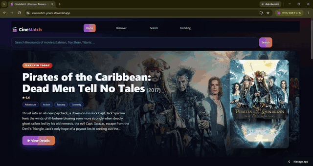
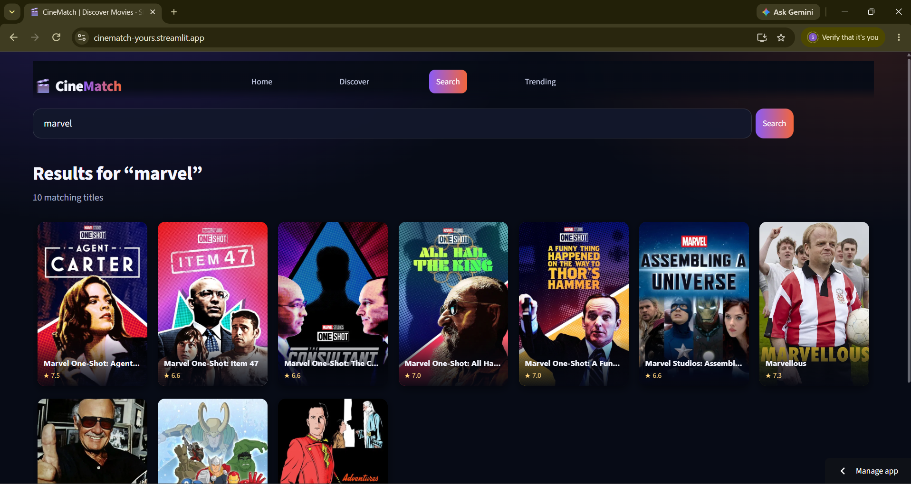
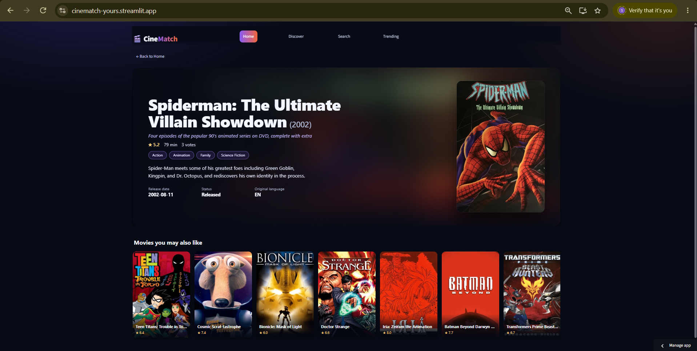

# 🎬 CineMatch — Movie Recommendation System

**Discover your next favorite movie.**

CineMatch is a content-based movie discovery application built with Python, FastAPI, Streamlit, Pandas, and Scikit-learn. It helps users explore more than 45,000 movies, view movie details, and discover similar movies using TF-IDF and cosine similarity.

🌐 **[Live Demo](https://cinematch-yours.streamlit.app/)** · 💻 **[GitHub Repository](https://github.com/shridhartapakire/movie-recommendation-system)**

## 🎥 Live Application Preview



*Explore CineMatch's cinematic interface, animated movie posters, and movie discovery experience.*

## 📸 Screenshots

### Movie Search



### Movie Details and Recommendations



## ✨ Features

- **Movie Search:** Search a dataset containing more than 45,000 movies.
- **Movie Details:** Explore genres, release dates, ratings, descriptions, and posters.
- **Similar Movie Recommendations:** Discover movies using TF-IDF and cosine similarity.
- **Cinematic Homepage:** Featured hero section and five animated poster rows moving in alternating directions.
- **Personalized Discovery:** Explore "Because You Watched" and "Recommended For You" rows based on movies you open.
- **Discover and Trending:** Browse movies by genre, popularity, rating, votes, and release date.
- **TMDB Integration:** Retrieve current movie posters and backdrop images.
- **Caching and Resilience:** Cache poster lookups and handle temporary TMDB outages.
- **Separate Frontend and Backend:** Streamlit provides the interface, while FastAPI serves movie data and recommendations.

## 🛠️ Tech Stack

- **Language:** Python
- **Frontend:** Streamlit, HTML, CSS, JavaScript
- **Backend:** FastAPI, Uvicorn
- **Data Processing:** Pandas, NumPy
- **Machine Learning:** Scikit-learn, TF-IDF, cosine similarity
- **Movie Data and Images:** The Movie Database (TMDB) API
- **Model Storage:** Hugging Face Hub
- **Deployment:** Streamlit Community Cloud and Render

## 🏗️ Architecture

1. Users interact with the CineMatch frontend hosted on Streamlit Community Cloud.
2. The frontend sends API requests to the FastAPI backend hosted on Render.
3. The backend uses the saved movie metadata and TF-IDF artifacts to generate recommendations.
4. The model artifacts are stored in a private Hugging Face repository and downloaded by the backend when needed.
5. TMDB provides current poster and backdrop information.

**Deployment services:**
- Frontend: [Streamlit](https://cinematch-yours.streamlit.app/)
- Backend: [Render API](https://cinematch-api-ykog.onrender.com/)
- Model storage: [Hugging Face model repository](https://huggingface.co/shridhartapakire/cinematch-model-files) *(private)*

## 📂 Project Structure

```text
movie-recommendation-system/
├── app.py
├── main.py
├── recommender.py
├── build_model.py
├── components/
│   └── cinematch_wall/
│       └── index.html
├── .streamlit/
│   └── config.toml
├── screenshots/
│   ├── CineMatch_demo.gif
│   ├── CineMatch_MovieSearch.png
│   └── CineMatch_MovieDetails_Recommendations.png
├── test_recommender.py
├── test_saved_model.py
├── test_api.py
├── test_model_download.py
├── movie_recommendation.ipynb
├── requirements.txt
├── render.yaml
├── README.md
└── .gitignore
```

The local `model/` directory contains generated model artifacts. The movie dataset, model artifacts, and `.env` file are excluded from Git.

## ⚙️ Run Locally

### Requirements

- Python compatible with the project dependencies
- The movie metadata dataset used to build the model
- A TMDB API Read Access Token for current poster lookups

### 1. Clone the repository

```bash
git clone https://github.com/shridhartapakire/movie-recommendation-system.git
cd movie-recommendation-system
```

### 2. Create and activate a virtual environment

```bash
python -m venv .venv
```

On Windows PowerShell:

```powershell
.\.venv\Scripts\Activate.ps1
```

### 3. Install dependencies

```bash
python -m pip install -r requirements.txt
```

### 4. Prepare the movie dataset and model

Place `movies_metadata.csv` in the project root, then run:

```bash
python build_model.py
```

This generates the saved model artifacts in the local `model/` directory. The dataset and generated artifacts are not included in the Git repository.

### 5. Configure TMDB

Create a `.env` file in the project root:

```text
TMDB_BEARER_TOKEN=your_tmdb_bearer_token
```

Never commit your real API token to GitHub.

### 6. Start the FastAPI backend

```bash
uvicorn main:app --reload
```

API documentation: [http://127.0.0.1:8000/docs](http://127.0.0.1:8000/docs)

### 7. Start the Streamlit frontend

Open a second terminal, activate the same virtual environment, and run:

```bash
python -m streamlit run app.py
```

Open the local URL displayed in the terminal.

## 🔌 API Endpoints

| Endpoint | Purpose |
|---|---|
| `GET /health` | Check API and model status |
| `GET /search?query=&limit=` | Search movie titles |
| `GET /movie?title=&year=` | Retrieve movie details |
| `GET /recommend?title=&year=&limit=` | Get similar movie recommendations |
| `GET /home?watched=&per_row=` | Retrieve the featured movie and homepage rows |
| `GET /browse?genre=&sort=&limit=` | Browse and sort movies |
| `GET /genres` | Retrieve genres and movie counts |

## 🧠 How Recommendations Work

1. Movie metadata and descriptions are cleaned and prepared.
2. Genre and plot text are combined into textual features.
3. TF-IDF converts the text into numerical vectors.
4. Cosine similarity compares the movie vectors.
5. The system returns movies with the highest similarity scores.

The recommendation engine uses saved model artifacts, allowing recommendations to be generated without rebuilding the model for every request.

## 🧪 Testing

Validate the saved model:

```bash
python test_saved_model.py
```

Run recommendation tests:

```bash
python test_recommender.py
```

Run API tests:

```bash
python test_api.py
```

Run model-download tests:

```bash
python test_model_download.py
```

The recommendation tests require the local dataset and rebuild the model. API tests use mocked TMDB responses. The model-download tests validate download behavior and error handling.

## 🚀 Deployment

CineMatch is deployed using separate frontend and backend services.

- **Streamlit Community Cloud** hosts the user interface.
- **Render** hosts the FastAPI backend.
- **Hugging Face Hub** stores the model artifacts in a private repository.
- **TMDB** provides current movie poster and backdrop information.

The deployed backend retrieves missing model artifacts from Hugging Face using environment variables. Secret tokens are configured in the hosting services and should never be committed to the repository.

## 🔮 Future Improvements

- Add more recommendation strategies and personalization options.
- Improve recommendation performance and model evaluation.
- Expand automated testing and deployment monitoring.
- Explore additional movie discovery and filtering features.

## 👨‍💻 Author

**Shridhar Tapakire**

- [GitHub](https://github.com/shridhartapakire/movie-recommendation-system)
- [Live CineMatch Application](https://cinematch-yours.streamlit.app/)

---

*Built with Python, machine learning, and a love for movies. 🍿*
